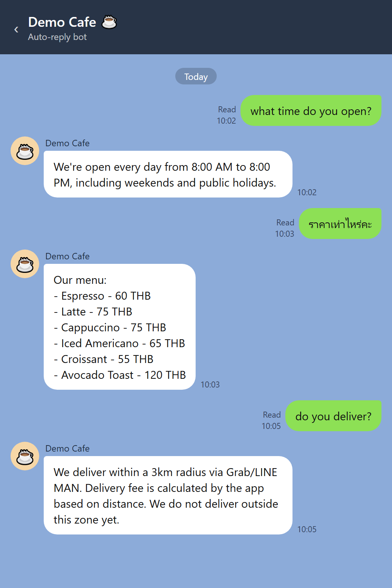

# LINE auto-reply bot for small businesses

**A LINE chatbot that answers a shop's customers instantly, in Thai or English, and hands the chat to a real person when it isn't sure.**

Small shops in Thailand get most customer questions on LINE: *"what time do you open?"*, *"how much is a latte?"*, *"do you deliver?"*. When the owner is busy, those messages sit unanswered and customers go elsewhere. This bot replies straight away, using only the shop's real information.

This version is set up for a demo café. Swap one file and it becomes any shop's bot.

## What a chat looks like



<sub>The replies are the bot's real output from running its code. The chat window is recreated in LINE's style for this picture.</sub>

More examples, including when Claude steps in:

| Customer types | Bot replies | How it decided |
|---|---|---|
| what time do you open? | We're open every day from 8:00 AM to 8:00 PM, including weekends and public holidays. | Keyword match ("open"): instant and free |
| ราคาเท่าไหร่ *(how much?)* | Our menu: Espresso 60 THB, Latte 75 THB, Cappuccino 75 THB, Iced Americano 65 THB… | Thai keyword match ("ราคา") |
| do you deliver to Silom? | We deliver within a 3km radius via Grab/LINE MAN… | Keyword match ("deliver") |
| hi, thanks so much! | A short, friendly reply in the customer's language | No keyword, so Claude writes it |
| can you make a birthday cake for Saturday? | Says thanks, and that they'll check with the owner and follow up | Not in the shop's info, so Claude **doesn't make up an answer** |
| do you have parking? | That's a great question. Let me check with the team and get back to you shortly! 🙏 | Claude isn't sure, so it **hands off to a human** |

<sub>Keyword replies come word for word from the shop's info (shortened here). Claude writes its replies fresh each time, so the wording varies.</sub>

## How it decides what to say

```
customer message
   │
   ├─ 1. Matches a keyword (English or Thai)?  ──►  send the shop's stored answer
   │
   ├─ 2. No match → ask Claude, giving it ONLY the shop's info  ──►  natural reply
   │
   └─ 3. Claude would have to guess?  ──►  hand off to a human
```

- **Keywords first.** Most questions (hours, menu, delivery, location) get an exact answer from `business_data.json`. That's fast, free, and always correct.
- **AI for everything else.** Claude replies in the customer's language, keeps it short, and is told never to invent prices, hours or policies.
- **Honest hand-off.** If the answer isn't in the shop's info, the customer hears that a person will follow up, instead of getting a made-up answer.

## Make it any shop's bot

1. Put the shop's real hours, menu, delivery zone and location in `business_data.json`.
2. Add the ways their customers actually ask things to `KEYWORD_MAP` in `reply_logic.py`.

That's it. The rest of the code stays the same.

## Tech

Python · Flask · LINE Messaging API (line-bot-sdk v3) · Claude API

## Run it yourself

```bash
pip install -r requirements.txt
export LINE_CHANNEL_SECRET=...        # from the LINE Developers Console
export LINE_CHANNEL_ACCESS_TOKEN=...
export ANTHROPIC_API_KEY=...
python app.py
```

Expose it with `ngrok http 5000` and set `https://<your-ngrok-url>/callback` as the webhook in the LINE Developers Console. To keep it running all the time, deploy to Railway or Render with the same three environment variables.
